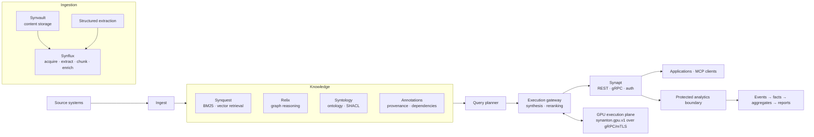
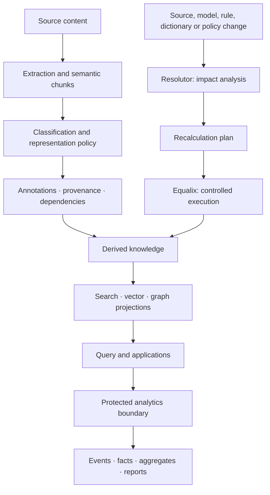

# Synanton Platform

**Open-source systems research for enterprise knowledge and reliable business execution.**

Synanton explores how enterprise knowledge can be ingested, structured, secured, searched, reasoned over, and recalculated as a coherent system—not a collection of disconnected AI components.

The platform is developed through versioned designs, incremental implementations, runnable demos, contract tests, benchmarks, and security/failure tests. **Architecture approval is not implementation or production-readiness approval.**

- **Architecture:** [Platform Architecture 1.0](docs/architecture/synanton-platform-architecture-1.0.md) — capstone for Designs 1.22–1.34; implementation status is tracked in [§15](docs/architecture/synanton-platform-architecture-1.0.md#15-current-implementation-status).
- **Implementation index:** [Architecture index](docs/architecture/INDEX.md) · [Documentation inventory](docs/DOCUMENTATION-INVENTORY.md)
- **License:** [Apache 2.0](LICENSE)

## Architecture

Knowledge is treated as **derived state**. The platform separates ingestion, knowledge projections, query execution, and analytics behind explicit contracts.



The GPU execution plane is isolated from the CPU/control plane by a versioned gRPC contract, allowing model serving and GPU capacity to evolve independently. This diagram is a conceptual view; individual components and end-to-end paths have different implementation status.

### Knowledge lifecycle and recalculation



Changes to inputs or processing rules can invalidate derived knowledge and its projections. Resolutor plans dependency-aware recalculation; Equalix provides controlled execution. The goal is to recompute the smallest correct portion of state while preserving provenance and security.

## Core research areas

- **Structured ingestion:** preserve document structure, semantic chunks, citations, provenance, and security labels.
- **Hybrid retrieval and reasoning:** combine keyword and vector search with graph reasoning and ontology constraints.
- **Secure derived knowledge:** carry tenant and authorization constraints through transformations and projections.
- **Annotations and recalculation:** make definitions, dependencies, processing runs, and derived state explicit.
- **Analytics:** derive protected metrics from platform activity without creating a second source of truth or a security side channel.
- **Isolated AI execution:** keep expensive inference workloads behind stable contracts, with observable execution and failure behavior.

See the [implementation documentation](docs/implementation) and [research plans](docs/research) for scope, experiments, and evidence.

## Modules

| Module / plane | Responsibility |
| --- | --- |
| **Synvault** | Content storage and source adapters |
| **Synflux** | Acquisition, extraction orchestration, chunking, enrichment, and embedding |
| **Synquest** | BM25 and vector retrieval |
| **Relix** | Graph reasoning, GraphRAG, and graph connectors |
| **Syntology** | Ontology, SHACL validation, and versioning |
| **Synapt / Gateway / Planner** | API ingress, query planning, execution, synthesis, and reranking |
| **GPU execution plane** | Isolated model execution through the `synanton.gpu.v1` contract |
| **Annotations / Resolutor / Equalix** | Provenance and dependencies, impact analysis, recalculation planning, and controlled execution |
| **Analytics plane** | Events, analytical facts, aggregates, metrics, and reports |

This is a component map, not a roll-up of design status. Code or contracts may exist while a broader design plane remains incomplete. The authoritative per-design status and evidence are in [Architecture 1.0 §15](docs/architecture/synanton-platform-architecture-1.0.md#15-current-implementation-status).

## Security

The shared security contract spans [platform, UI, and security-provider](docs/security/security-model.md). Platform must fail closed on missing or untrusted tenant context and must not treat caller-supplied tenant headers as identity.

- Phase 1 demo-path rejection of caller-supplied tenant fields is documented; it is **not** proof of platform-wide enforcement.
- Platform-wide tenant enforcement—including row-level security, transaction-scoped tenant context, tenant-scoped repositories/cache keys, and cross-tenant denial tests—is tracked in [#339](https://github.com/synanton/platform/issues/339).
- Identity issuance/verification and client-side token isolation belong to adjacent projects; see the [security model](docs/security/security-model.md) for ownership and current scope.

## Quick start

Requirements and service-specific setup vary by demo. Start with the [development setup and demo documentation](docs/demos) and the [implementation index](docs/implementation).

```bash
# Unit tests (no Docker required)
./gradlew test

# Acceptance tests (requires Docker)
./gradlew acceptanceTest
```

For the local ingestion demo, the repository includes a Docker Compose stack and sample documents. Follow the current [demo instructions](docs/demos) for the required services, profiles, and ingestion commands. Copy `.env.example` and configure secrets before starting services:

```bash
cp .env.example .env
```

## Documentation

- [Platform Architecture 1.0](docs/architecture/synanton-platform-architecture-1.0.md) — architecture decisions and implementation status
- [Architecture index and design history](docs/architecture/INDEX.md)
- [Documentation index](docs/INDEX.md) · [Documentation inventory](docs/DOCUMENTATION-INVENTORY.md)
- [Annotations, recalculation, analytics and reporting](docs/implementation/annotations-analytics-plane/INDEX.md)
- [Semantic chunking](docs/implementation/semantic-chunking/INDEX.md)
- [Structured content extraction](docs/implementation/content-extraction-plane/INDEX.md)
- [GPU execution plane](docs/implementation/gpu-execution-plane/INDEX.md)
- [Eventing and workflow plane](docs/implementation/eventing-workflow-plane/INDEX.md)
- [Platform API plane](docs/implementation/platform-api-plane/INDEX.md)
- [Vertical-slice acceptance and diagnostic runbook](docs/implementation/vertical-slice/INDEX.md)
- [Vector-engine selection and benchmark evidence](docs/architecture/vector-engine-selection.md) · [Retrieval evaluation plan](docs/research/retrieval-evaluation-benchmark-plan.md)

## Project status

Synanton is an active research and engineering project, not a finished enterprise product. Designs 1.22–1.34 are integrated into Architecture 1.0 and approved at the design level; implementation is partial and varies by plane. The 1.27 eventing/workflow contract and 1.32 platform API contract are frozen, with implementation and acceptance work continuing. See the linked architecture status table and plane-specific implementation plans for the current source of truth rather than relying on a dated README snapshot.

## Related projects

- **Resolutor** — dependency-aware impact analysis and recalculation planning
- **Equalix** — fair scheduling and resource-controlled execution
- **GPU Execution Plane** — isolated inference infrastructure
- **Structured Content Extractor** — deployment-neutral document extraction
- **Lucentrix / Commitix** — ingestion, search, durable execution, and workflow experiments

## Contact

- Research and general inquiries: research@synanton.org
- Security reports: security@synanton.org
