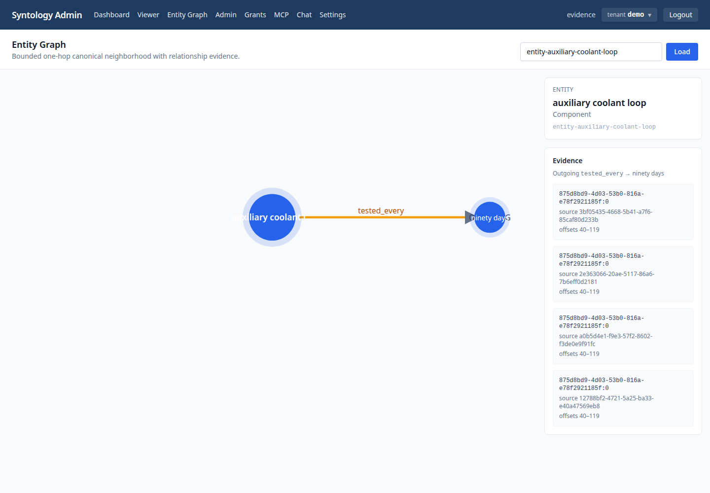

# K8s RAKG activation — 2026-11-11

**Status:** activated; live Entity Graph E2E green.
**Activation tree:** `56a2613` runtime wiring plus `8a5a7332` Relix restart fix and the evidence-only docs commit.
**Cluster:** homelab, Kubernetes `v1.37.0`, namespace `synanton`.
**#592 state:** OPEN — evidence is for the current transitional seam; the post-#592 rerun remains required when #592 merges.
**Artifacts:** [`artifacts/k8s-activation-2026-11-11/`](artifacts/k8s-activation-2026-11-11/).

## Result

The complete local-style journey ran against the deployed stack:

```text
upload -> extraction -> graph commit -> resolution -> validation -> promotion
       -> Relix Entity Graph UI with relation evidence
```

Live Playwright test:

```text
✓ 1 tests/entity-graph.live.spec.ts:102:1 › live Entity Graph journey from upload to evidence (25.1s)
1 passed (25.9s)
```

The test used the deployed UI at `http://192.168.10.31:30080` and a port-forwarded
Synflux API. It uploaded `halcyon-7-directive.txt`, waited for the pipeline, opened
`entity-auxiliary-coolant-loop`, asserted the `tested_every` edge to `ninety days`,
clicked the edge, and verified the evidence chunk/version/offsets.



## Source status

```text
source_id                       entity-graph-live-1794419350315
version_id                      12788bf2-4721-5a25-ba33-e40a47569eb8
extraction_status               KNOWLEDGE_READY
graph_status                    PARTIAL
resolution_status               PARTIAL
mentions_accepted               10
mentions_rejected               0
relations_accepted              2
relations_rejected              2
resolved                        8
review_required                 1
unresolved                      1
```

`PARTIAL` is expected for this live Qwen extraction: the document adds a
`Person -> Document` `signs` relation and an `UNKNOWN -> Measurement` `records`
relation that the demo ontology does not admit. The target `tested_every` edge and
its evidence were accepted and are what #599 exercises. The source status is not
being reported as `GRAPH_COMMITTED`/`COMPLETED`; that is a documented limitation,
not a hidden success.

## Activation flags

```text
synflux: EXTRACTION_CONSUMER_ENABLED=true EXTRACTION_GRAPH_ENABLED=true PROMOTION_PRODUCER_ENABLED=true
synquest: RESOLUTION_CONSUMER_ENABLED=true
relix: PROMOTION_CONSUMER_ENABLED=true RECONCILIATION_ENABLED=true
tenants: demo
RELIX_BASE_URL: http://relix.synanton.svc.cluster.local:8084
SYNTOLOGY_BASE_URL: http://syntology.synanton.svc.cluster.local:8080
```

## Images actually pulled

```text
synflux              .../synflux@sha256:4456a013eadc358041b90a16c62068b52f769e9550fb2f7a6a34f2c6d1e70d03
synquest             .../synquest@sha256:36c2dd955825dbba487f35f7237c086bc73aabe94b33b55bee6f4c1c0e70822c
relix                .../relix@sha256:bdafdcfc7389cacec6fd7852d0f83eb5145452870a35a7d50a0bf49e6a14a2dd
syntology            .../syntology@sha256:140978caca4fe000d1bd5b7edb86959abe2470163ad13102373c20100bf147fd
ui                   .../ui@sha256:2224befca476ac14e15bfc11e5cef180e56b5bd245e2a3907834979b22a69401
extraction-gateway   .../extraction-gateway@sha256:89f7f4bbffea68c049f79464b72f09b217be6be12200186b5eb0258c9d2869fb
neo4j                .../neo4j@sha256:95a95861b621c682662b8138371bc96be200571165f128c0a0287e590268c32c
```

See `artifacts/.../images.txt` for the full list.

## Deployment and fixes applied during activation

- Started required gpu-plane inference: `tei-embedding` and `vllm-extraction`.
- Ran `IMAGE_TAG=local-real-demo ./scripts/mirror-images.sh` and `./scripts/deploy-demo.sh`.
- Enabled the flags above on the correct services (promotion/reconciliation on
  Relix, not Synquest).
- Seeded canonical entities with the demo tenant substitution and projected nine
  entities into Synquest.
- Fixed the Neo4j service-link env collision (`enableServiceLinks: false`), the
  `NEO4J_AUTH` slash format, and the readiness timeout.
- Fixed `synflux`/`synquest` volume ownership for the glibc image (`fsGroup: 999`
  plus an init-container chown).
- Rebuilt the UI image with the Entity Graph and fixed its Relix proxy rewrite
  and optional-service upstreams.

## Live fault injection

The live restart scenario was run after activation:

- Synquest was deleted after graph commit while resolution was in flight. After
  restart, the source reached `resolution_status=COMPLETED` with
  `resolved=8`, `review_required=1`, `unresolved=1`, `failed=0`.
- Relix was deleted after resolution/promotion. Before and after restart,
  Neo4j held `9` canonical `:Entity` nodes and `2` `:REL` edges; the Entity Graph
  still returned `tested_every` with evidence. The post-restart E2E passed in
  25.7s.

A second run deleted **both** Synquest and Relix simultaneously after graph
commit. Both replacements became Ready; resolution reached `PARTIAL`; Neo4j
retained `:Entity=9`/`:REL=2`; duplicate-active-resolution and duplicate-REL
counts were both `0`; and the full E2E passed again in 25.6s. See
`artifacts/.../combined-fault.txt`.

The first Relix restart exposed a destructive bug: `Neo4jGraphConnector.loadTenant()`
deleted all canonical `:Entity`/`:REL` data and reloaded from Cassandra (which has
no canonical entities), and `RelixApplication` called it on every startup. That
left the graph empty and the UI showed "No neighbors for this entity." Fixed in
`8a5a7332` by skipping projection-store `loadTenant()` for the Neo4j connector.
See `artifacts/.../fault-injection.txt`.

The loader was hardened further in PR #612: `Neo4jGraphConnector.loadTenant()` is
now additive/upsert-only and writes nodes + edges in one transaction. ADR-025
records the invariant. Testcontainers coverage: repeated load, partial snapshot,
and interrupted load all preserve existing canonical data; full Relix suite:
**122 tests green**.

## Evidence files

- `playwright.txt` — passing E2E output.
- `playwright-post-restart.txt` — E2E output after the fixed Relix restart.
- `fault-injection.txt`, `fault-injection-source.txt` — restart scenario and source status.
- `combined-fault.txt`, `combined-fault-source.txt` — simultaneous Synquest + Relix kill.
- `playwright-combined-post.txt` — E2E after the combined restart.
- `entity-graph.png` — Entity Graph with `tested_every` and evidence panel.
- `source-status.txt` — Cassandra source status/counters.
- `images.txt`, `flags.txt`, `pods.txt`, `gpu-plane-pods.txt`.

## Remaining

- **#592:** if merged, rerun the #589 gate and #599 on the post-#592 tree; this
  evidence is pre-#592.
- A full combined K8s consumer/reconciler fault-injection bundle was not run in
  this activation window; #595 provides the local real-store fault-injection
  evidence for the current seam.
