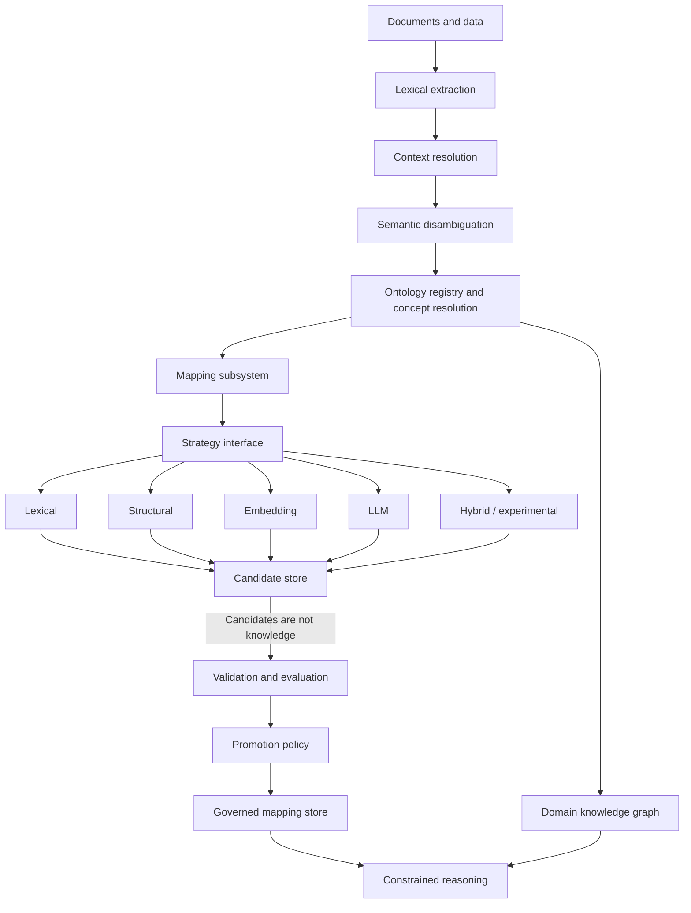
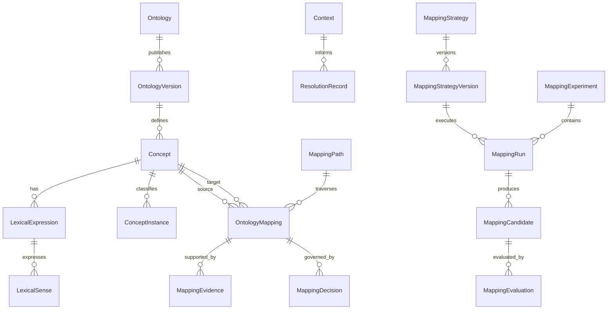

# Domain Ontologies and Cross-Domain Semantic Mapping

**Version:** 0.3  
**Status:** Approved architectural baseline — specification remains open  
**Date:** 2026-11-14  
**Supersedes:** v0.2 as the current proposal baseline; v0.2 remains historical  
**Implementation status:** The mapping subsystem is not implemented by this document.

> This is an immutable architecture baseline, not a finished subsystem specification. Detailed decisions are owned by ADRs. Approval does not authorize implementation beyond the phase gates below.

## 1. Executive Summary

Synanton needs domain-specific ontology ownership, contextual semantic interpretation, cross-domain interoperability, and controlled reasoning. As a research platform, it must also support experimentation with different ontology-mapping approaches without making any one algorithm part of the semantic model.

The architecture separates:

1. **Stable semantic core:** ontology and concept identity, context, mapping relations, evidence, provenance, versions, validation and governance.
2. **Replaceable mapping strategies:** algorithms that generate, match, score or validate mapping candidates.
3. **Research and evaluation infrastructure:** experiments, run records, benchmark governance and comparative evaluation.

The semantic core and strategy implementations have separate change and versioning processes. A strategy version change does not imply a semantic-core change; changing canonical relation semantics requires an explicit architecture decision.

> A mapping's meaning must not depend on the algorithm that proposed it. Algorithms can change; governed semantic assertions must remain interpretable.

## 2. Architectural Principles

1. Domain autonomy: each ontology owns its concepts and definitions.
2. Explicit interoperability: cross-domain correspondence is represented through governed mappings.
3. Contextual interpretation: semantic decisions retain the context in which they were made.
4. Stable semantic core, replaceable algorithms.
5. Experimentation without contamination of canonical knowledge.
6. Reproducible and comparable evaluation, with honest determinism claims.
7. Provenance and versioning throughout the knowledge lifecycle.

## 3. Terminology

| Term | Meaning |
|---|---|
| Taxonomy | Hierarchical classification, usually based on `is-a` relationships |
| Ontology | Formal representation of concepts, properties, relationships and constraints |
| Lexical expression | A word or phrase found in a source |
| Lexical sense | A particular meaning of an expression |
| Concept | An ontology-owned semantic definition |
| Instance | An individual entity represented using ontology concepts |
| Context | Conditions relevant to interpreting an expression or assertion |
| Mapping | A governed semantic relationship between concepts |
| Mapping candidate | A proposed relationship awaiting evaluation or governance |
| Mapping strategy | An algorithm or pipeline that generates or evaluates candidates |
| Mapping experiment | A reproducible definition of a comparative research task |
| Mapping run | One execution of a mapping experiment |

A taxonomy may form part of an ontology. A lexical expression is not itself a concept, and a mapping candidate is not automatically a governed mapping.

## 4. Architecture Overview



Canonical concept resolution and the knowledge graph are structurally isolated from experimental mapping. The reasoning layer consumes governed mappings, not experimental candidates.

## 5. Concept Identity and Ontology Ownership

### 5.1 Stable identifiers

Every concept has a globally addressable identifier, preferably an IRI. Identity remains stable across releases while the underlying concept remains the same.

### 5.2 Ownership

Each concept belongs to an authoritative ontology. The registry records ontology identity, namespace, owner, governance policy, published versions, dependencies/imports, concept identifiers and lifecycle.

### 5.3 Versioning and immutability

Ontology identity is distinct from immutable published-version identifiers. Published releases are technically immutable; corrections produce new releases.

### 5.4 Lifecycle

Proposed lifecycle: `Active → Deprecated → Retired`. A `replacedBy` relationship indicates a successor, not automatic identity or equivalence. Duplicate concepts across ontologies remain distinct until an explicit relationship is established.

### 5.5 Canonical identity authority

ADR-030 (proposal-local ONT-ADR-001) must name the canonical identity authority. Equalix's actual contract must be inspected first. Entity-instance equality and ontology-class equivalence are separate operations. If Equalix cannot own ontology identity decisions, a named ontology registry/resolution service must own them.

## 6. Context Model

Context is a first-class, versioned object.

### 6.1 Dimensions

A context may include domain/subdomain, organization or tenant, source and document type, task, environment, time, actor/role, constraints, assumptions and provenance. Domains support graph/faceted composition rather than requiring a strict tree.

### 6.2 Composition and conflicts

Context may be derived from source declarations, task requirements, organizational configuration and ontology applicability. Conflicting assertions are preserved, not silently overwritten. Multiple candidate contexts and unresolved ambiguity are valid outcomes.

ADR-031 (ONT-ADR-002) defines the machine-readable schema, constraint evaluation, precedence scope (global, per-domain or per-task), first-class conflict representation and immutable context references. Resolution records pin the exact context version or content hash used.

## 7. Domain Ontology Layer

Each domain ontology owns its definitions and constraints.

**Maritime examples:** Vessel, Cargo Ship, Passenger Ship, Maritime Port, Navigation Route.  
**Space examples:** Spacecraft, Cargo Spacecraft, Crew Transport Vehicle, Spaceport, Orbital Trajectory.

An optional minimal foundational ontology may provide abstractions such as Entity, Event, Process, Agent, Resource, Activity and Location. It must not impose artificial equivalence between domain-specific concepts.

## 8. Mapping Domain Model

### 8.1 Mapping assertion

A governed mapping records identifier/version, source and target concept identifiers, source/target ontology versions, relation and direction, applicability, evidence, validation, governance status and provenance.

### 8.2 Direction convention

The global convention is:

**`source —relation→ target` means the target bears the stated relation to the source.**

Thus `MaritimeShip → Broader → TransportVehicle` means `TransportVehicle` is broader than `MaritimeShip`. Strategies and APIs must use this convention; the core validates it.

### 8.3 Canonical relation vocabulary

| Relation | Meaning | Default operation |
|---|---|---|
| Equivalent | Same intended semantic extension under stated assumptions | Conditional substitution |
| Broader | Target is broader than source | Directional discovery |
| Narrower | Target is narrower than source | Directional discovery |
| Related | Explicitly relevant relationship | Discovery |
| Similar | Semantic similarity | Candidate discovery |
| Analogous | Structural or functional analogy | Analogy discovery |
| Lexical correspondence | Linguistic correspondence | Search or translation |

The semantic core owns this vocabulary. OWL/SKOS translations must not drift semantically: OWL `equivalentClass` is a strong logical assertion; SKOS `exactMatch` and `closeMatch` are not interchangeable with OWL equivalence.

### 8.4 Reasoning permissions

Default mapping behavior enables discovery and translation, not unrestricted inference. Equivalent mappings may enable bidirectional substitution only when assumptions, constraints and validation requirements hold.

ADR-032 (ONT-ADR-003) defines substitution semantics, path composition, OWL/SKOS translation, negative mappings and disjointness assertions.

### 8.5 Negative knowledge

Rejected mappings, explicit non-equivalence, disjointness assertions, counterexamples and applicability exclusions are persistent, versioned, strategy-independent core objects. A rejected proposal is suppressed or flagged on re-proposal unless new evidence or changed ontology versions justify reconsideration; ADR-033 formalizes this rule.

### 8.6 Evidence and lifecycle

Evidence includes positive/negative examples, counterexamples, applicability boundaries, source and ontology versions, validation results and reviewer decisions. Similarity scores are not evidence by themselves.

Lifecycle: `Proposed → UnderReview → Validated → Accepted`, with `Rejected`, `Deferred`, `Deprecated` and `Superseded` alternatives. Candidates remain separate from governed assertions until explicit promotion.

## 9. Pluggable Mapping Architecture

### 9.1 Stable core and replaceable strategies

The semantic core defines identity, relation semantics, evidence, provenance, versioning and governance. Strategies implement algorithms; they cannot redefine concept identity, relation semantics or governance.

### 9.2 Pipeline stages

| Stage | Responsibility |
|---|---|
| Candidate generation | Find possible correspondences |
| Matching | Propose relation types |
| Context evaluation | Evaluate applicability |
| Scoring | Estimate candidate similarity or relevance |
| Validation | Check semantic and structural consistency |
| Decision | Accept, reject or defer under policy |

A strategy may implement one or more stages. Both stage-composable and end-to-end strategies are supported.

### 9.3 Strategy families

The architecture can accommodate lexical, structural, rule-based, embedding-based, LLM-based, graph-based, hybrid and experimental strategies. These are examples, not an implementation commitment.

### 9.4 Capability declaration

Every strategy declares a versioned capability descriptor: implemented stages; supported relation types; evidence types; determinism class; external-service dependencies; permitted data classifications; required context features; and expected cost/latency class. The core validates outputs against the declaration.

### 9.5 Scores

A strategy score is a candidate attribute. It is not automatically mapping confidence, validation status, semantic validity or governance acceptance. Promotion reconciles score, evidence, validation and risk.

### 9.6 Strategy interface

Conceptual interface:

```text
MappingStrategy
  describeCapabilities()
  generateCandidates(sourceConcepts, targetOntology, context, configuration)
  evaluateCandidates(candidates, evaluationContext, configuration)
```

Stage-specific implementations may implement only a subset of operations. The capability declaration is authoritative for what a strategy actually does.

### 9.7 Candidate/governed-store separation

Candidate and governed mapping stores are physically separated. The reasoning layer cannot read experimental candidates as knowledge.

Promotion is explicit and audited: it references the candidate and evidence, applies validation/governance policy, creates a strategy-independent governed assertion, and retains originating strategy, strategy version, experiment and run provenance.

ADR-040 (ONT-ADR-011) specifies the storage isolation mechanism and atomic promotion boundary.

## 10. Research Experiments and Reproducibility

### 10.1 Research entities

`MappingStrategy`, `MappingStrategyVersion`, `MappingExperiment`, `MappingRun`, `MappingCandidate`, `MappingEvaluation`, `MappingDecision` and `MappingPath`.

### 10.2 Run records

Each run records strategy ID/version, model provider and version, parameters/thresholds/seed/temperature where applicable, input ontology version IRIs, context version/hash, dataset revision, validation configuration, determinism class, execution provenance, cost, latency and candidate references.

### 10.3 Determinism

Classes: Deterministic, Seeded, Best-effort reproducible, Non-reproducible. External model APIs may not permit bit-for-bit reproduction. The platform promises comparable re-execution under pinned inputs where possible and records divergence.

### 10.4 Benchmark independence

Gold-standard datasets are governed independently of strategies. Development and hold-out splits, annotation guidelines, reviewer agreement, disagreements and counterexamples are retained. Strategy authors do not tune against the final hold-out set.

### 10.5 Comparative evaluation

Strategies are compared against identical ontology versions, context, dataset revision and protocol. Report quality, cost, latency and determinism as trade-offs, not one aggregate score.

## 11. Mapping Paths and Provenance

A `MappingPath` composes governed mappings only. By default, a path is usable only when every edge's applicability conditions hold and an explicit `reasoningPolicy` permits the path and operation. Each edge retains mapping ID/version, concept and ontology versions, relation, applicability, validation status and provenance. Candidate edges are not knowledge. ADR-042 (ONT-ADR-013) defines composition semantics.

## 12. Knowledge Graph Layer

The graph distinguishes ontology concepts from individual instances and retains concept/ontology release references, instance identity, context, provenance, mapping references, resolution history and original/recomputed interpretations. Experimental candidates remain outside the canonical graph unless promoted.

## 13. Agent and Reasoning Integration

Agents access semantic capabilities through explicit APIs. Results distinguish direct facts, ontology-derived inferences, governed mapping correspondences, contextual interpretations, probabilistic hypotheses and unverified hypotheses. Agents may propose mappings but cannot bypass governance. Cross-domain inference requires explicit validated permissions.

## 14. Integration with Synanton Components

- **RAKG/Synflux:** extraction and evidence preservation; retain the sequence lexical expression → context → candidate concepts → canonical resolution → graph assertion. Pre-entities remain useful intermediate representations.
- **Syntology:** ontology registry/management and structural/SHACL validation. SHACL validation is not proof of equivalence.
- **Equalix:** inspect its actual equality contract; instance equality and class equivalence are separate.
- **Resolutor:** coordinates asynchronous processing, dependencies, resumability and provenance; it does not own ontology semantics.
- **Canonical concept resolution:** one explicitly designated owner.
- **Provenance:** source → span → pre-entity → context → resolution → candidate → validation → promotion → graph assertion.

## 15. API and Policy Contracts

Proposed APIs:

```text
resolveConcept(expression, context, sourceEvidence, resolutionPolicy)
getConcept(conceptId, ontologyVersion)
findMappings(sourceConcept, targetDomain, mappingTypes, context)
validateMapping(mappingId, mappingVersion, validationPolicy)
querySemanticKnowledge(query, context, reasoningPolicy, provenanceRequired)
runMappingExperiment(experimentDefinition)
compareMappingRuns(runIds, evaluationProtocol)
promoteMappingCandidate(candidateId, promotionPolicy)
```

Policies: `resolutionPolicy` controls candidate generation, context, ambiguity and abstention; `validationPolicy` controls validators, constraints and evidence; `reasoningPolicy` controls relations, path depth and inference; `strategySelectionPolicy` controls eligible strategies, capabilities, costs and data restrictions; `promotionPolicy` controls evidence, validation, risk and review.

Field-level policy schemas are deliverables of ADR-033 (ONT-ADR-004) and ADR-039 (ONT-ADR-010). APIs enforce authorization, tenant isolation, version consistency, explicit ambiguity, provenance and defined error/retry semantics.

## 16. Governance and Security

Automated acceptance is risk-based. ADR-033 defines risk using relation type, domain criticality, tenant scope, evidence quality, validation and safety/regulatory implications. High-impact mappings require human review. Triage prevents low-quality experimental candidates from overwhelming reviewers.

Security includes tenant isolation, role-based authorization, evidence access controls, external-service data restrictions, audit, immutable releases, retention/deletion rules and backup/recovery.

## 17. Evaluation

Three dimensions are distinct:

1. **Offline benchmark:** precision, recall, abstention, false-equivalence rate, context-sensitive resolution, cost, latency and determinism.
2. **Governance outcomes:** acceptance/rejection/deferral, review effort, reversal, staleness, provenance completeness and repeated rejected proposals.
3. **Comparative evaluation:** identical pinned inputs and trade-off curves.

Recall is measured against a defined gold standard; incomplete/disputed annotations remain explicit. Report metrics per domain and relation type, not only in aggregate.

Initial targets are provisional calibration goals, not release gates: concept-resolution precision ≥95%, recall ≥85%, accepted-mapping precision ≥95%, provenance completeness 100%, zero critical constraint violations, correct abstention ≥95%. Calibrate by domain and relation type after dataset creation. Define a critical violation before making zero violations a gate.

## 18. Implementation Roadmap

### Phase 1 — Identity and Context Foundation

Minimal ontology registry; stable concept identifiers; ownership and immutable release references; structured/versioned context; lexical expressions and senses; ambiguity preservation; provenance; RAKG integration. No mapping engine. Exit gates: ADR-030, ADR-031, ADR-038 and ADR-039.

### Phase 2 — Pluggable Mapping Core

Canonical mapping vocabulary; strategy abstraction/capabilities; physically separated candidate and governed stores; explicit promotion; two contrasting strategies (e.g. lexical and structural); one validator; minimal evaluation harness and reproducible run records. Exit gates: ADR-032, ADR-033, ADR-034, ADR-040 and ADR-041. Benchmark dataset work is a parallel Phase 2 workstream and a gate for meaningful comparative claims.

### Phase 3 — Governance and Evolution

Negative knowledge, mapping lifecycle, human review, staleness detection, audit, foundational ontology and reasoning-profile decisions.

### Phase 4 — Agent Integration

Semantic query APIs, constrained cross-domain inference, mapping-path composition and path-level provenance. Exit gates: ADR-035 and ADR-042.

### Phase 5 — Continuous Evolution

Ontology change impact analysis, mapping recalculation, strategy improvement and governance feedback loops.

## 19. Architecture Decision Register

The proposal-local identifiers below are stable references within this document. Repository-wide ADR numbers are assigned separately to avoid collisions with the existing platform ADR sequence.

| Proposal-local ID | Repository ADR | Decision | Priority / gate |
|---|---:|---|---|
| ONT-ADR-001 | ADR-030 | Concept identity, namespace, ownership and canonical authority | P0; Phase 1 exit |
| ONT-ADR-002 | ADR-031 | Context schema, composition and conflict resolution | P0; Phase 1 exit |
| ONT-ADR-003 | ADR-032 | Mapping semantics, direction and reasoning permissions | P0; Phase 2 |
| ONT-ADR-004 | ADR-033 | Mapping governance and automated acceptance | P0; Phase 2 |
| ONT-ADR-005 | ADR-034 | Domain hierarchy and composition | High; Phase 2 |
| ONT-ADR-006 | ADR-035 | Cross-domain inference policy | High; Phase 4 |
| ONT-ADR-007 | ADR-036 | Foundational ontology scope | Medium; Phase 3 |
| ONT-ADR-008 | ADR-037 | OWL 2 reasoning profile | Medium; Phase 3 |
| ONT-ADR-009 | ADR-038 | Historical concept and instance versioning | High; Phase 1 exit |
| ONT-ADR-010 | ADR-039 | Registry and mapping API contracts | High; Phase 1 exit / Phase 2 |
| ONT-ADR-011 | ADR-040 | Strategy abstraction and capability contracts | P0; Phase 2 |
| ONT-ADR-012 | ADR-041 | Experiment reproducibility and benchmark governance | P0; Phase 2 |
| ONT-ADR-013 | ADR-042 | Mapping path composition and provenance | P1; before agent reasoning |

## 20. Consolidated Data Model

### Semantic core

`Ontology`, `OntologyVersion`, `Concept`, `LexicalExpression`, `LexicalSense`, `Context`, `ConceptInstance`, `OntologyMapping`, `MappingEvidence`, `RejectedMapping`, `DisjointnessAssertion`, `Counterexample`, `MappingPath`.

### Experimental subsystem

`MappingStrategy`, `MappingStrategyVersion`, `MappingExperiment`, `MappingRun`, `MappingCandidate`, `MappingEvaluation`.

### Governance

`MappingDecision`, `ValidationResult`, `PromotionRecord`.

### Principal relationships



Cardinalities and required/optional fields are formalized in ADRs and implementation contracts. `MappingDecision` is strategy-independent: it references the candidate and promotion record but does not carry strategy-specific semantics into the governed assertion.

## 21. Outstanding Risks

| Risk | Mitigation |
|---|---|
| Concept identity conflicts | ADR-030 and explicit ownership |
| Context ambiguity | Structured contexts and conflict records |
| Semantic drift between strategies | Canonical relation vocabulary |
| Candidate contamination | Physical store separation |
| Non-reproducible experiments | Immutable run records and determinism classes |
| Benchmark leakage | Independent hold-out governance |
| Governance overload | Candidate triage and promotion policy |
| Strategy interface overfitting | Two contrasting initial strategies |
| Incorrect mapping composition | ADR-042 and constrained reasoning |

## 22. Final Recommendation

This baseline establishes four independent capabilities:

1. **Semantic identity:** what a concept is and who owns its definition.
2. **Contextual interpretation:** why an expression or assertion is interpreted in a particular way.
3. **Ontology mapping:** how independently governed concepts are related and what operations those relationships permit.
4. **Mapping experimentation:** how alternative algorithms propose, evaluate and compare mappings without redefining the semantic core.

> Domain autonomy provides semantic correctness. Explicit mappings provide interoperability. Context provides the conditions under which both can be trusted. A stable semantic core with replaceable strategies provides the ability to improve mappings without redefining them.

## Repository registration note

This proposal is an approved architecture baseline, not a finished specification or implementation claim. Repository ADRs are globally numbered; proposal-local ONT-ADR identifiers map to ADR-030–ADR-042 in `docs/architecture/decisions/INDEX.md`. v0.3 is immutable after approval; later architectural changes require a new version and changelog entry.
