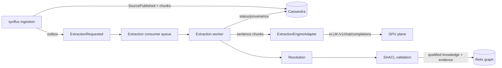

# RAKG Phase 2 — asynchronous extraction consumer (design)

**Status:** PR #1 emission + PR #2 consumer + PR #3 validated graph persistence + PR #3.5 hardening landed (2026-11-08); canonical resolution is PR #4
**Date:** 2026-11-08
**Issue:** #560 (RAKG), follow-up to ADR-022
**Preview seam:** `POST /api/v1/extraction/preview` (synchronous, diagnostic only)

## Problem

The extraction adapter is correct and measured (entity F1 0.618 / relationship
F1 0.078 on the frozen gold), but it must not run inline in ingestion:

- a 50-page document is ~200 chunks;
- one Qwen3-4B call is ~1–2 s on the extraction GPU;
- 200 synchronous calls add 3–7 minutes to an upload, exhaust HTTP timeouts, and
  hold an ingestion worker while the GPU is the bottleneck.

Search must not wait for extraction. BM25/dense chunks are useful immediately;
entities and relations are a **derived projection** that can be built later and
rebuilt independently.

## Decision

1. **Ingestion stays unchanged.** Synflux acquires, extracts text, chunks,
   embeds, persists, and publishes the existing `SourcePublished`/outbox event.
   It never calls `ExtractionEngineAdapter` inline.
2. **Emit `ExtractionRequested` atomically with `SourcePublished`.** The source
   outbox is the `source_versions` row (one event slot today). PR #1 adds a
   second `extraction_event_*` slot to that same row and writes both events in
   the same `INSERT ... IF NOT EXISTS` LWT — one partition, no cross-partition
   conditional batch. `SearchProjectionConsumer` writes `search_projected_at`
   after the Lucene commit; the extraction consumer must gate on
   `search_projected_at IS NOT NULL` before reading chunks. Registry key:
   `ExtractionRequested@1` (wire label `extraction.requested.v1`), `REPLAY_SAFE`;
   duplicate LWT retries are possible (hazard H-2), so the consumer dedupes by
   `(source identity, version_id)`.
3. **A separate extraction consumer owns the LLM loop.** It runs as its own
   worker (separate deployment, same codebase seam) and:
   - loads the document's sentence chunks from Cassandra;
   - calls the configured `ExtractionEngineAdapter` in bounded batches
     (`extraction.consumer.batch-size`, default 8; concurrency per GPU);
   - resolves pre-entities (retrieval-assisted, next phase), validates with
     SHACL, and commits qualified knowledge + provenance to Relix;
   - records per-document status and metrics.
4. **Status is explicit and search-independent.**
   `INGESTED` (chunks/search ready) → `EXTRACTING` → `KNOWLEDGE_READY`;
   failures go to `EXTRACTION_FAILED` with a retryable reason. The UI shows
   search as available throughout.
5. **Idempotent by document version.** At-least-once delivery is expected:
   re-processing replaces the document's extraction generation, never appends.
   `SourceDeleted`/new version cancels or supersedes outstanding work; stale
   generations are discarded before commit.
6. **Bounded, fair, observable.** Per-tenant concurrency and a global GPU
   semaphore; exponential backoff with a dead-letter state after N attempts;
   metrics for queue depth, chunks/s, call latency, failure rate, token usage,
   and extraction generation. A sampling job can re-score a frozen set to catch
   prompt/model drift.

## Flow



## Pinned emission decision (PR #1, landed)

- `source_versions` is the source outbox; extraction is a second event slot on
  that row (`extraction_event_id/type/payload/published/...`), not a second
  `manifest_transitions_outbox` row. The existing LWT already targets one row.
- `source_versions.search_projected_at` is the readiness gate, written by
  `SearchProjectionConsumer` (not the Kafka `OutboxPublisher`).
- The event payload is the typed `ExtractionRequested` envelope in
  `java/synflux/.../events`; the typed envelope is validated by
  `EventTypeRegistry`.
- Acceptance evidence: the fixture lifecycle integration test asserts both the
  `SourcePublished` and `ExtractionRequested` slots, matching version/content
  ref, and the readiness write-back.

## Event contract (draft)

```json
{
  "event_id": "uuid",
  "event_type": "ExtractionRequested",
  "tenant_id": "demo",
  "content_ref_id": "uuid",
  "source_version_id": "uuid",
  "processing_run_id": "uuid",
  "chunk_manifest_version": 3,
  "chunk_count": 82,
  "requested_at": "2026-11-08T00:00:00Z",
  "trace_id": "..."
}
```

- Idempotency key: `(tenant_id, content_ref_id, source_version_id)`.
- Consumer verifies the version is still current before each batch and before
  commit; a superseded generation is dropped without writing graph state.
- `SourceDeleted` emits `ExtractionCancelled` (or the consumer observes the
  tombstone) and deletes the generation's derived knowledge.

## PR #2 implementation (landed)

- `ExtractionConsumer` (`@Scheduled(fixedDelay=5s)`) polls at most one document
  per invocation, processes its chunks sequentially through the adapter, and
  stores per-chunk `PreEntity`/`RelationCandidate` JSON in
  `ingestion_cache.extraction_results` (the pre-Relix stub).
- Status transitions: `PENDING` at emission, `EXTRACTING` at pickup,
  `KNOWLEDGE_READY` on success (and `extraction_event_published=true`), or
  `EXTRACTION_FAILED` with attempt/backoff and `published=false` for retry.
- The scheduler pool is 4 so the long extraction call does not block workflow
  recovery; the consumer itself never runs concurrently for one bean.
- `GET /v1/sources/{sourceId}/status` exposes `extraction_status`.
- Safe defaults: consumer disabled and provider `regex`; enable with
  `EXTRACTION_CONSUMER_ENABLED=true` and `EXTRACTION_PROVIDER=llm`.
- Results table is overwritten per `(content_ref_id, chunk_ordinal)`; the graph
  commit path remains out of scope.

## PR #3 implementation (landed)

- Syntology: `POST /api/v1/ontology/validate-relation` returns
  `{conformant, violations}` using TBox domain/range + predicate SHACL shapes.
- Relix: `GraphWritePort` upserts `:ExtractedMention` and validated
  `:EXTRACTED_RELATION` edges; InMemory and Neo4j adapters, MERGE-based
  idempotency; a real Neo4j Testcontainers test proves write-twice == one node.
- Synflux: `GraphWriter` derives SHA-256 ids, preserves chunk/document offsets,
  validates each relation, writes mentions + accepted edges, and records
  `graph_status`/`graph_validation_counters`.
- `extraction_status` still means extraction+persistence; `graph_status`
  (`PENDING|VALIDATING|GRAPH_COMMITTED|PARTIAL|FAILED`) is separate.
- Nothing writes canonical `:Entity`, `:REL`, or `:RESOLVES_TO` yet.

### PR #3.5 hardening

- graph writes require a verified tenant JWT; no body fallback
- independent `GraphCommitConsumer` retries PENDING/FAILED graph commits from
  persisted results (no LLM re-call), with LWT claim + attempt/backoff (V21)
- evidence chunk id is taken from the current segment, never the model
- Relix returns actual persisted counts; the writer fails on any shortfall
- Neo4j unique `(tenant_id, mention_id)` constraint + concurrent-write test
- transitive type inheritance for relation domain/range

## Failure and retry

| Failure | Behavior |
|---|---|
| vLLM unavailable / 5xx | retry with backoff; document stays `INGESTED`; search unaffected |
| malformed model JSON | retry once with the strict reminder; then `EXTRACTION_FAILED` |
| SHACL violation | reject the document's extraction generation; keep the previous valid generation |
| stale version | discard; no retry |
| repeated failure | dead-letter + alert; manual replay endpoint (ops-only) |

## Non-goals (this phase)

- No inline LLM calls in synflux ingestion.
- No new search dependency on extraction; search remains the fast path.
- No cross-document entity resolution in Phase 2 (retrieval-assisted resolution
  is Phase C of #560).
- No UI component work beyond the status chip; the preview endpoint is the
  diagnostic surface.

## Rollout

1. Event + consumer in shadow mode (`EXTRACTION_CONSUMER_ENABLED=false`): emit and
   log, do not call the GPU.
2. Enable for one tenant; compare extraction against the frozen gold and a
   sample of real documents.
3. Enable globally with per-tenant concurrency; keep `EXTRACTION_PROVIDER=regex`
   as the deterministic fallback and the inline path off.
4. Only after resolution/SHACL acceptance: mark `KNOWLEDGE_READY` as the graph
   commit state.

## Acceptance criteria

- Uploading a 200-chunk document returns immediately and is searchable while
  extraction runs.
- The consumer processes the document without blocking the ingestion worker;
  status transitions and graph provenance are visible.
- Re-delivery of `ExtractionRequested` does not duplicate graph facts.
- Deletion/supersession removes or replaces the generation.
- Frozen-gold metrics are reproducible from the consumer's persisted output.
- No tenant can observe another tenant's extraction status, prompts, or graph
  facts.

## Open questions

- Dedicated `extraction-worker` service vs. a consumer group inside synflux
  (start with a separate deployment behind the same outbox contract).
- Graph commit transaction boundary: Relix batch API vs. an outbox projection
  for graph writes.
- Token-budget accounting and per-tenant GPU quotas.
- Which status transitions the existing Operation API can express vs. a new
  `extraction_state` field.
